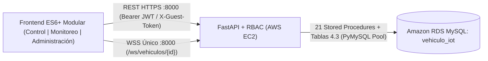

# Plataforma Telemática IoT integrada (Prácticas 4.1, 4.2 y 4.3) 🚜📡🎮

Plataforma web modular (**Mobile First**) con tres módulos integrados sin recarga de página:
**CONTROL | MONITOREO | ADMINISTRACIÓN**, conectada a **FastAPI (AWS EC2)**, **Amazon RDS (MySQL 8.0)** y **WebSocket Seguro (WSS)**.

Desarrollado por **Nadia Itzel Salvador · 2026**.

---

## 🌐 Enlaces del Proyecto

* **Aplicación Web Pública (GitHub Pages):** [https://nadias33.github.io/control_iot_web/](https://nadias33.github.io/control_iot_web/)
* **Documentación Swagger UI (AWS EC2 HTTPS):** [https://52.202.139.21:8000/docs](https://52.202.139.21:8000/docs)
* **Canal WebSocket Seguro (WSS):** `wss://52.202.139.21:8000/ws/vehiculos/{id_vehiculo}`
* **Repositorio:** [https://github.com/nadias33/control_iot_web](https://github.com/nadias33/control_iot_web)

---

## 🏗️ Arquitectura General y Continuidad 4.1 / 4.2 / 4.3



### Indicadores Independientes de Conectividad
1. **WSS:** estado real del WebSocket del navegador (`En línea` / `Conectando...` / `Desconectado`). *No acredita conexión física del ESP8266.*
2. **API:** salud del servidor FastAPI en AWS EC2 (`Disponible` / `No disponible` / `Comprobando`).
3. **RDS:** diagnóstico real reportado por `GET /health` desde MySQL (`Disponible` / `No disponible` / `Sin verificar`).

---

## 👥 Modelo Comercial y Control de Acceso (RBAC + Propiedad)

| Rol | Alcance en Plataforma | Restricciones de Seguridad en Backend & WSS |
| :--- | :--- | :--- |
| **ADMINISTRADOR** | Dashboard con métricas reales, CRUD de Modelos comerciales y capacidades, CRUD de Unidades físicas, Clientes, Asignaciones, Demos de fábrica y Bitácora. | No puede operar unidades en estado `vendido` salvo que el propietario active explícitamente `soporte_autorizado`. |
| **USUARIO** | Selector **Mis Vehículos**, Control y Monitoreo exclusivo de unidades propias, autorización de soporte remoto y Editor Visual de DEMOs privadas. | Bloqueo `403 Forbidden` (BOLA/IDOR) al intentar consultar o controlar unidades de otro comprador vía REST o WSS. |
| **INVITADO** | Consulta del catálogo público (`Prueba nuestros vehículos IoT`) y reserva temporal exclusiva (máx. 120s) sobre unidades en `exhibicion`. | Comandos restringidos (`AVANZAR`, `RETROCEDER`, `GIRAR`, `DETENER`); rechazo `409 Conflict` ante sesiones simultáneas; detención segura al caducar o desconectar. |

---

## 🗄️ Base de Datos y Migraciones Versionadas (`migrations/`)

La evolución separa **Modelo Comercial** (`modelos_vehiculo` + `modelo_comandos`) de **Unidad Física** (`vehiculos` con `id_modelo`, `numero_serie` único y `estado_comercial`) conservando intactos todos los registros históricos y Stored Procedures de 4.1 y 4.2.

* `migrations/V001__admin_iot_up.sql` — Agrega `roles`, `usuarios`, `modelos_vehiculo`, `modelo_comandos`, `asignaciones_vehiculo`, `sesiones_invitado`, `bitacora_auditoria` y amplía `vehiculos` y `demos`.
* `migrations/V001__admin_iot_down.sql` — Reversión controlada para entornos de prueba sin tocar tablas históricas.
* `migrations/verify_migration.sql` — Conteos antes/después e integridad referencial.

> **Nota sobre DDL en MySQL:** Las sentencias `CREATE TABLE` y `ALTER TABLE` realizan *commit implícito* en InnoDB. Se debe tomar Snapshot RDS y respaldo `mysqldump` antes de aplicar `V001__admin_iot_up.sql`.

---

## ⚙️ Variables de Entorno (Backend `.env` — Solo Nombres)

* `DB_HOST` — Endpoint DNS de Amazon RDS MySQL.
* `DB_PORT` — Puerto MySQL (`3306`).
* `DB_USER` — Usuario de base de datos.
* `DB_PASSWORD` — Contraseña de base de datos (nunca publicada en GitHub ni frontend).
* `DB_NAME` — Esquema (`vehiculo_iot`).
* `DB_POOL_SIZE`, `DB_CONNECT_TIMEOUT`, `DB_READ_TIMEOUT` — Parámetros del pool de conexiones.
* `AUTH_SECRET_KEY`, `AUTH_TOKEN_EXPIRE_MINUTES`, `GUEST_SESSION_MAX_SECONDS` — Firma HS256 y expiración de sesiones.

---

## 🚀 Despliegue y Verificación

1. **Aplicar migración en Amazon RDS** (previo Snapshot + `mysqldump`):
   ```bash
   mysql -h <DB_HOST> -u admin -p vehiculo_iot < migrations/V001__admin_iot_up.sql
   mysql -h <DB_HOST> -u admin -p vehiculo_iot < migrations/verify_migration.sql
   ```
2. **Actualizar Backend en AWS EC2 (`C:\websocket_iot`) y reiniciar Uvicorn:**
   ```powershell
   python -m uvicorn app.main:app --host 0.0.0.0 --port 8000 --ssl-keyfile key.pem --ssl-certfile cert.pem
   ```
3. **Ejecutar pruebas de seguridad y flujo (P01–P17):**
   ```powershell
   python tests/test_admin_security.py
   ```
4. **Autorización de certificado autofirmado en navegadores:** abrir `https://52.202.139.21:8000/docs`, aceptar la advertencia de seguridad y recargar el frontend.

---

## ⚠️ Limitaciones Documentadas

* El estado `En línea` de **WSS** refleja la conexión entre el navegador y FastAPI; no garantiza por sí solo que el microcontrolador físico **ESP8266** tenga energía o cobertura WiFi.
* Al usar certificado TLS autofirmado en EC2 por IP directa, cada navegador nuevo debe aceptar `https://52.202.139.21:8000/docs` antes de consumir REST/WSS.
